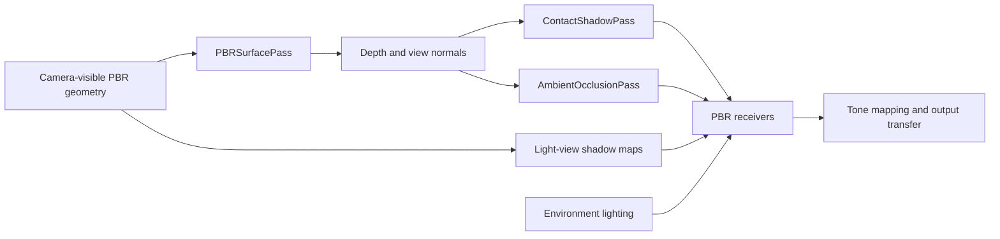

# Combining Lighting, Shadows, and Ambient Occlusion

Start with a physically based material and explicit lighting. Add shadow maps for light
visibility, contact shadows for short-range directional refinement, and ambient occlusion
only when nearby surfaces need less indirect illumination. These effects solve different
parts of the lighting calculation; enabling all of them is not a requirement.

The [PBR Shadows example](/examples/api/pbr-shadows) keeps these choices in one scene.
Its bouncing sphere makes contact-shadow fade visible as the sphere lifts away from the
plane. The same controls compare shadow maps, contact shadows, both, and ambient-occlusion
quality without creating separate example applications.

## Terms

| Term | Expansion | What it does here |
| --- | --- | --- |
| PBR | Physically Based Rendering | A material response driven by surface properties and illumination. |
| IBL | Image-Based Lighting | Indirect illumination sampled from an environment map. |
| AO | Ambient Occlusion | Approximate nearby obstruction of indirect illumination. |
| SSAO | Screen-Space Ambient Occlusion | The cheaper AO evaluator, sampling nearby depth values. |
| GTAO | Ground-Truth Ambient Occlusion | The higher-quality AO evaluator, integrating visible horizons. The name does not imply exact visibility of geometry outside the depth buffer. |
| PCF | Percentage-Closer Filtering | Smooths shadow-map visibility by combining depth comparisons. |
| PCSS | Percentage-Closer Soft Shadows | Estimates blockers to vary shadow softness with separation. |
| HDR | High Dynamic Range | Lighting/color values with a wider intensity range than ordinary display color. |
| SDR | Standard Dynamic Range | The ordinary display range after exposure, tone mapping, and output transfer. |

## Which effect changes which light?

| Mechanism | Inputs | Contribution affected | Main limitation |
| --- | --- | --- | --- |
| Environment lighting | Prefiltered radiance, diffuse environment, material | Adds indirect diffuse/specular light | An environment does not automatically capture local scene occlusion. |
| Shadow maps | Light-view geometry and depth | Each supported light's direct contribution | Resolution, bias, light-view coverage and filtering. |
| Contact shadows | Camera depth/normals and one directional-light direction | First directional light's direct contribution | Only surfaces visible in the current camera depth buffer can block rays. |
| AO visibility | Camera depth/normals | Ambient light, IBL and lightmaps in opt-in PBR receivers | Approximation from a single visible depth layer; it does not add cast shadows for individual lights. |
| Material occlusion map | Authored texture/UVs | Existing material behavior | Authored data cannot follow new object motion or scene changes. |

Contact shadows combine with a directional shadow map using the minimum visibility, not
by multiplying two estimates of the same direct-light occlusion. AO is applied separately
to indirect contributions. Direct lights and emission retain their energy when screen-space
AO changes. Authored material occlusion remains independent; avoid unintentionally stacking
several strong approximations of the same crease.

## AO choices: none, cheap, good

| Choice | API mode | Use when | Cost and quality |
| --- | --- | --- | --- |
| None | `'none'` | The scene already reads clearly, authored lighting is sufficient, or the backend lacks AO support. | Returns a constant unoccluded texture and records no AO draws. |
| Cheap | `'ssao'` | You want a modest contact/crease cue with a smaller evaluation budget. | 12 nearby depth samples followed by two depth-aware blur passes. Perspective camera only; radius is in pixels. |
| Good | `'gtao'` | Nearby surfaces need a more convincing horizon-based visibility estimate. | Four slices, six samples per side, followed by the same two blur passes. Perspective camera only; radius is in view-space scene units. |

These labels are quality choices, not a guarantee that one option always meets a frame-time
budget. `AmbientOcclusionPass` defaults to GTAO at half resolution. Half resolution reduces
intermediate pixel count to about one quarter; the returned mask is full input resolution.
Small creases can soften at reduced resolution. Compare quality and frame time in your scene.

Both current AO evaluators require WebGPU. On WebGL2, select `'none'` and keep rendering.
The example exposes only that choice on WebGL2 and explains the limitation in its info panel.
PBR mask receiving itself supports WebGL2 and WebGPU, so another producer may supply a mask.

## Record one surface prepass, then share its outputs



Record light-view shadow maps and the camera surface prepass before drawing receivers.
Contact shadows and AO share camera depth and encoded view normals; neither owns or
recaptures the scene. The receiver then accumulates lighting with the appropriate visibility
factors. Tone mapping and output transfer happen once, after accumulation.

```typescript
import {AmbientOcclusionPass} from '@luma.gl/engine/lighting';

const occlusion = new AmbientOcclusionPass(device, {
  mode: device.type === 'webgpu' ? 'gtao' : 'none',
  resolutionScale: 0.5
});

// Record surfaces.render(...) first. Use this same frame's camera projection.
const visibility = occlusion.render({
  depthTexture: surfaces.depthTexture,
  normalTexture: surfaces.normalTexture,
  projectionMatrix,
  near: 0.1,
  far: 40
});
// receiver was constructed with receiveAmbientOcclusion: true.
receiver.shaderInputs.setProps({
  pbrAmbientOcclusion: {
    ambientOcclusionTexture: visibility,
    viewport: [0, 0, width, height],
    strength: 1,
    enabled: true
  }
});
// Record receivers, then let the application submit.
```

Use physical pixels for both attachments and the receiver viewport. Depth, normals,
projection and viewport must describe the same camera/frame. A nonzero viewport origin
must be included in mask receiving props. SSAO near/far values must match its perspective
projection. GTAO and contact shadows use the backend-native projection and its inverse.

## Visibility versus color postprocessing

Use `AmbientOcclusionPass` with PBR receiving when the material pipeline can apply visibility
at light accumulation. It reuses the existing SSAO/GTAO evaluators and depth-aware blur;
it does not introduce another AO algorithm. It has no temporal history or velocity input.

Existing `createSSAOCompositeShaderPass` and `createGTAOCompositeShaderPass` exports in
`@luma.gl/engine/effects` remain available for postprocessing. Multiplying complete scene
color also darkens direct light and emission. GTAO's `composition: 'ambient-only'` avoids
that by requiring a separately supplied ambient-light color texture. This is a different
contract from a visibility mask bound to a PBR receiver.

The existing GTAO composite includes temporal reprojection and needs a matching velocity
texture. The reusable surface prepass currently supplies depth and normals, not motion
vectors. Do not substitute zero velocities for moving objects or cameras to claim temporal
stability. Integrating motion-vector production and shared history is a separate step.

## Ownership, resizing, and tuning

Passes borrow input attachments. Returned masks belong to their pass; rebind the returned
texture each frame because intermediate/output storage may alternate. Input-size changes
resize and replace owned allocations. Submit work before destroying/replacing referenced
resources. Destroying a pass releases its targets and execution resources, not the caller's
surface textures, materials, or receiver models.

Start with a short contact-ray distance and modest AO strength. Larger AO radius or contact
distance cannot recover offscreen geometry and can exaggerate halos or thin-surface errors.
Bias reduces self-occlusion at the cost of detached contacts. Thickness describes contact
ray hits, not AO radius. Camera motion and disocclusion can reveal sampling noise; the new
visibility passes intentionally contain no stale history.

## API references

- [PBR materials](../../api-reference/engine/lighting/pbr-material.md) and [models](../../api-reference/engine/lighting/pbr-model.md).
- [Prefiltered environments](../../api-reference/engine/lighting/prefiltered-environment.md).
- [Camera surface prepass](../../api-reference/engine/lighting/pbr-surface-pass.md).
- [PBR shadow receiving](../../api-reference/engine/lighting/pbr-shadows.md) and [contact shadows](../../api-reference/engine/lighting/contact-shadows.md).
- [Ambient visibility](../../api-reference/engine/lighting/ambient-occlusion.md).
- [SSAO composite](../../api-reference/shaders/shader-passes/ssao.mdx) and [GTAO composite](../../api-reference/shaders/shader-passes/gtao.mdx).

## Baked diffuse lighting

Use [LightmapBaker](../../api-reference/engine/lighting/lightmap-baker.md) for static,
UV-unwrapped surfaces. Record sampled lighting and shadow maps in texture space, accumulate
irradiance, then bind the result to PBR materials. Reset after bake inputs change.
Baked light can include direct illumination: disable corresponding live contributions to
avoid counting them twice. Baking does not replace dynamic-object lighting or screen-space effects.

The [Lightmap Baking example](/examples/api/lightmap-baking) combines shadowed
punctual lights and directional samples from `sampleLightmapEnvironment`. On
WebGPU it also traces two diffuse bounces for indirect color bleed. The
[lightmaps guide](./features/lightmaps.mdx) walks through baking a glTF scene
and reloading its HDR result.

Use `readLightmapData` and `encodeLightmapData` for explicit HDR export; reload with
`decodeLightmapData` and `createLightmapFromData`. The returned result owns its GPU texture;
CPU data and the matching geometry/UV layout remain application-owned. Exported irradiance is
linear, without tone mapping. Changing the lights marks the example bake stale until reset.


## Frame and resource lifecycle

Keep one surface prepass per camera, shared by AO and contact shadows. Prepare model uniforms
before opening its render pass. Record the visibility passes after surfaces, bind their returned
textures to receivers, and then draw receivers. Shadow maps may be prepared earlier in the frame.
Clustered light lists select light candidates independently of visibility; constructing a grid does
not automatically make the standalone PBR shader consume it. The application still supplies its
cluster-aware shading consumer.

Use one update/consume sequence per mutable pass or grid per submission. Uniform buffers and
scratch targets are reused; recording several differently parameterized views before submitting
can overwrite inputs needed by earlier work. Use separate instances for independent views.

| Change | Required action |
| --- | --- |
| Camera resolution or device pixel ratio | Submit outstanding work, resize the surface pass in physical pixels, then render AO/contact again and rebind returned masks and receiver viewports. |
| Camera matrices without a resolution change | Refresh surface, visibility and receiver matrices together. Rebuild cluster lists using the matching projection and depth range. |
| Lighting, transforms or geometry used for a bake | Reset the baker before its next update. Camera movement alone does not invalidate a world-space bake. |
| Atlas resolution | Submit work referencing the old atlas, resize the baker, and reacquire its preview; resize also resets the sample count. |
| Replacing a material map | Follow the model's material-specialization/replacement contract; changing uniforms alone cannot add a shader feature. |
| Keeping a bake after producer disposal | Call `createResult()`, submit the copy, then bind its independent texture. Destroy that result when its consumers no longer need it. |

Same-size surface/baker resize calls preserve their allocations and bake sample count. Failed
surface draw callbacks end their render pass, allowing later passes to be recorded. A failed
surface/baker target allocation preserves the previous targets and dimensions and releases partial
replacements. These guarantees do not make arbitrary GPU allocation failures recoverable at the
application level; device loss still requires rebuilding device resources.

Destroy receiver and pass models when no recorded work references them. Materials borrow maps,
visibility passes borrow surface attachments, and clustered grids borrow light-record buffers.
Destroying those consumers does not transfer or release ownership of their inputs. A baker preview
is borrowed and becomes invalid on replacement/disposal; a submitted result copy survives both.

## Measure the complete workflow

Tune one cost at a time in the existing example: start with AO/contact disabled, enable shadow
maps, then contact shadows, then SSAO or GTAO. Keep camera, light count, shadow resolution,
viewport and device pixel ratio fixed when comparing. Warm pipelines before collecting samples.
Measure both CPU command recording and GPU execution; CPU `performance.now()` around recording
alone does not measure GPU time. A readback fence measures completion plus synchronization and
transfer overhead, not isolated shader execution. Use timestamp queries where supported to isolate
GPU passes, and keep readback out of the production render loop.

The workflow regression provides a small reproducible diagnostic:

```bash
yarn test-headless --no-coverage --reporter=json --outputFile=lighting-workflow-results.json \
  modules/engine/test/lighting/lighting-workflow.spec.ts
```

It runs on baseline and max-feature WebGPU, plus WebGL for combined PBR receiving. The shared
frame records surfaces, GTAO, contact shadows, clustered lists and a bake update. It verifies no
new texture or persistent-buffer allocations after warm-up, and that ordered-upload staging buffers
are destroyed after submission. Its timing annotations (also in JSON reporter test metadata) discard five warm-up frames and reports medians
over twenty frames, including CPU recording/submission and completion with a one-pixel readback.
These tiny fixtures test orchestration overhead, not scene throughput or a recommended frame budget;
timings have no CI pass/fail threshold. Repeat at production dimensions and record browser, GPU,
backend, feature level and power state before drawing performance conclusions.

Budget memory separately from timing. The following are logical storage sizes, excluding driver
alignment, pipelines, uniform buffers and any caller-owned inputs:

| Allocation | Storage budget |
| --- | --- |
| Camera surfaces | `8 × width × height` bytes for rgba8 normals and depth32 depth; about 15.8 MiB at 1920 × 1080. |
| Default baker targets | `56 × atlasWidth × atlasHeight` bytes: three rgba16 targets and two rgba32 history targets; 56 MiB at 1024². |
| Independent default bake result | Another `8 × atlasWidth × atlasHeight` bytes; 8 MiB at 1024². |
| Cluster output and scratch | `4 × clusterCount × (1 + maxLightsPerCluster + ceil(maxLightCount / 32)) + 80` bytes; about 1.07 MiB at the default capacities, excluding compute-model resources. |

AO/contact additionally allocate scaled evaluation/blur targets and full-size outputs. Half-scale
intermediates have about one quarter as many texels, but full-size surfaces and returned masks
remain. Increasing atlas width and height by two multiplies baker storage and raster work by four.
Dilation adds one full-atlas pass per step; keep it explicit and measure it separately from sampling.
