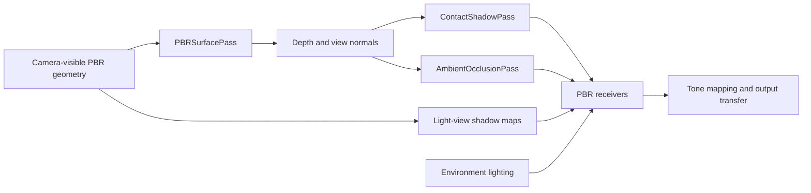

# Combining Lighting, Shadows, and Ambient Occlusion

Start with a physically based material and explicit lighting. Add shadow maps for light
visibility, contact shadows for short-range directional refinement, and ambient occlusion
only when nearby surfaces need less indirect illumination. These effects solve different
parts of the lighting calculation; enabling all of them is not a requirement.

The [PBR Shadows example](/examples/api/pbr-shadows) keeps these choices in one scene.
Its bouncing sphere makes contact-shadow fade visible as the sphere lifts away from the
plane. The same controls compare shadow maps, contact shadows, both, and ambient-occlusion
quality without creating separate example applications.

## Terms

| Term | Expansion | What it does here |
| --- | --- | --- |
| PBR | Physically Based Rendering | A material response driven by surface properties and illumination. |
| IBL | Image-Based Lighting | Indirect illumination sampled from an environment map. |
| AO | Ambient Occlusion | Approximate nearby obstruction of indirect illumination. |
| SSAO | Screen-Space Ambient Occlusion | The cheaper AO evaluator, sampling nearby depth values. |
| GTAO | Ground-Truth Ambient Occlusion | The higher-quality AO evaluator, integrating visible horizons. The name does not imply exact visibility of geometry outside the depth buffer. |
| PCF | Percentage-Closer Filtering | Smooths shadow-map visibility by combining depth comparisons. |
| PCSS | Percentage-Closer Soft Shadows | Estimates blockers to vary shadow softness with separation. |
| HDR | High Dynamic Range | Lighting/color values with a wider intensity range than ordinary display color. |
| SDR | Standard Dynamic Range | The ordinary display range after exposure, tone mapping, and output transfer. |

## Which effect changes which light?

| Mechanism | Inputs | Contribution affected | Main limitation |
| --- | --- | --- | --- |
| Environment lighting | Prefiltered radiance, diffuse environment, material | Adds indirect diffuse/specular light | An environment does not automatically capture local scene occlusion. |
| Shadow maps | Light-view geometry and depth | Each supported light's direct contribution | Resolution, bias, light-view coverage and filtering. |
| Contact shadows | Camera depth/normals and one directional-light direction | First directional light's direct contribution | Only surfaces visible in the current camera depth buffer can block rays. |
| AO visibility | Camera depth/normals | Ambient light, IBL and lightmaps in opt-in PBR receivers | Approximation from a single visible depth layer; it does not add cast shadows for individual lights. |
| Material occlusion map | Authored texture/UVs | Existing material behavior | Authored data cannot follow new object motion or scene changes. |

Contact shadows combine with a directional shadow map using the minimum visibility, not
by multiplying two estimates of the same direct-light occlusion. AO is applied separately
to indirect contributions. Direct lights and emission retain their energy when screen-space
AO changes. Authored material occlusion remains independent; avoid unintentionally stacking
several strong approximations of the same crease.

## AO choices: none, cheap, good

| Choice | API mode | Use when | Cost and quality |
| --- | --- | --- | --- |
| None | `'none'` | The scene already reads clearly, authored lighting is sufficient, or the backend lacks AO support. | Returns a constant unoccluded texture and records no AO draws. |
| Cheap | `'ssao'` | You want a modest contact/crease cue with a smaller evaluation budget. | 12 nearby depth samples followed by two depth-aware blur passes. Perspective camera only; radius is in pixels. |
| Good | `'gtao'` | Nearby surfaces need a more convincing horizon-based visibility estimate. | Four slices, six samples per side, followed by the same two blur passes. Perspective and orthographic cameras; radius is in view-space scene units. |

These labels are quality choices, not a guarantee that one option always meets a frame-time
budget. `AmbientOcclusionPass` defaults to GTAO at half resolution. Half resolution reduces
intermediate pixel count to about one quarter; the returned mask is full input resolution.
Small creases can soften at reduced resolution. Compare quality and frame time in your scene.

Both current AO evaluators require WebGPU. On WebGL2, select `'none'` and keep rendering.
The example exposes only that choice on WebGL2 and explains the limitation in its info panel.
PBR mask receiving itself supports WebGL2 and WebGPU, so another producer may supply a mask.

## Record one surface prepass, then share its outputs



Record light-view shadow maps and the camera surface prepass before drawing receivers.
Contact shadows and AO share camera depth and encoded view normals; neither owns or
recaptures the scene. The receiver then accumulates lighting with the appropriate visibility
factors. Tone mapping and output transfer happen once, after accumulation.

```typescript
import {AmbientOcclusionPass} from '@luma.gl/engine/lighting';

const occlusion = new AmbientOcclusionPass(device, {
  mode: device.type === 'webgpu' ? 'gtao' : 'none',
  resolutionScale: 0.5
});

// Record surfaces.render(...) first. Use this same frame's camera projection.
const visibility = occlusion.render({
  depthTexture: surfaces.depthTexture,
  normalTexture: surfaces.normalTexture,
  projectionMatrix,
  near: 0.1,
  far: 40
});
// receiver was constructed with receiveAmbientOcclusion: true.
receiver.shaderInputs.setProps({
  pbrAmbientOcclusion: {
    ambientOcclusionTexture: visibility,
    viewport: [0, 0, width, height],
    strength: 1,
    enabled: true
  }
});
// Record receivers, then let the application submit.
```

Use physical pixels for both attachments and the receiver viewport. Depth, normals,
projection and viewport must describe the same camera/frame. A nonzero viewport origin
must be included in mask receiving props. SSAO near/far values must match its perspective
projection. GTAO and contact shadows use the backend-native projection and its inverse.

## Visibility versus color postprocessing

Use `AmbientOcclusionPass` with PBR receiving when the material pipeline can apply visibility
at light accumulation. It reuses the existing SSAO/GTAO evaluators and depth-aware blur;
it does not introduce another AO algorithm. It has no temporal history or velocity input.

Existing `createSSAOCompositeShaderPass` and `createGTAOCompositeShaderPass` exports in
`@luma.gl/engine/effects` remain available for postprocessing. Multiplying complete scene
color also darkens direct light and emission. GTAO's `composition: 'ambient-only'` avoids
that by requiring a separately supplied ambient-light color texture. This is a different
contract from a visibility mask bound to a PBR receiver.

The existing GTAO composite includes temporal reprojection and needs a matching velocity
texture. The reusable surface prepass currently supplies depth and normals, not motion
vectors. Do not substitute zero velocities for moving objects or cameras to claim temporal
stability. Integrating motion-vector production and shared history is a separate step.

## Ownership, resizing, and tuning

Passes borrow input attachments. Returned masks belong to their pass; rebind the returned
texture each frame because intermediate/output storage may alternate. Input-size changes
resize and replace owned allocations. Submit work before destroying/replacing referenced
resources. Destroying a pass releases its targets and execution resources, not the caller's
surface textures, materials, or receiver models.

Start with a short contact-ray distance and modest AO strength. Larger AO radius or contact
distance cannot recover offscreen geometry and can exaggerate halos or thin-surface errors.
Bias reduces self-occlusion at the cost of detached contacts. Thickness describes contact
ray hits, not AO radius. Camera motion and disocclusion can reveal sampling noise; the new
visibility passes intentionally contain no stale history.

## API references

- [PBR materials](../../api-reference/engine/lighting/pbr-material.md) and [models](../../api-reference/engine/lighting/pbr-model.md).
- [Prefiltered environments](../../api-reference/engine/lighting/prefiltered-environment.md).
- [Camera surface prepass](../../api-reference/engine/lighting/pbr-surface-pass.md).
- [PBR shadow receiving](../../api-reference/engine/lighting/pbr-shadows.md) and [contact shadows](../../api-reference/engine/lighting/contact-shadows.md).
- [Ambient visibility](../../api-reference/engine/lighting/ambient-occlusion.md).
- [SSAO composite](../../api-reference/shaders/shader-passes/ssao.mdx) and [GTAO composite](../../api-reference/shaders/shader-passes/gtao.mdx).
