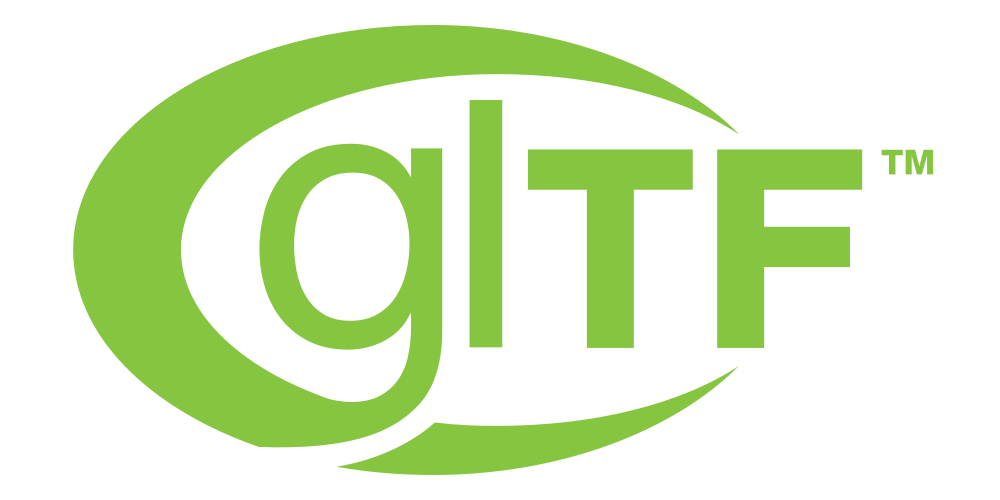

import {DocumentationBadge, DocumentationBadges} from '@site/src/components/docs/documentation-badges';
import {ANARIPlaygroundExample} from '@site/src/examples';
import {ClientOnlyLiveExample} from '@site/src/components/docs/client-only-live-example';

# @luma.gl/anari 🧪

<div className="docs-api-card__logos" role="group" aria-label="ANARI, glTF, and OpenUSD" style={{gap: '1rem'}}>
  <a href="https://www.khronos.org/anari/">
    
  </a>
  <a href="https://www.khronos.org/gltf/">
    
  </a>
  <a href="https://openusd.org/">
    
  </a>
</div>

<DocumentationBadges>
  <DocumentationBadge tone="experimental">Experimental</DocumentationBadge>
  <DocumentationBadge tone="version">From v10</DocumentationBadge>
</DocumentationBadges>

`@luma.gl/anari` provides an experimental retained-mode rendering API inspired by
the ANARI object model and built on luma.gl.

In retained mode, an application creates a scene from objects such as geometry,
materials, lights, and cameras. The library retains those objects between frames;
the application updates and commits their parameters when the scene changes.

To render, the application combines a world, camera, and renderer in a frame and
requests an image. The renderer interprets the scene using its rendering approach
and supported WebGPU or WebGL 2 backend. Renderer capabilities and backend support
vary.

This declarative model lets applications describe **what** to render while the
renderer handles **how** to render it. Compared with lower-level luma.gl APIs, it
offers less direct control over GPU execution in exchange for a simpler scene API
and the ability to experiment with different advanced rendering techniques.

:::caution[ANARI-inspired API]
This experimental API is inspired by the Khronos ANARI standard specification.
It is not an official or conformant
ANARI implementation or C binding, and is not affiliated with or endorsed by
The Khronos Group. ANARI and its logo are trademarks of The Khronos Group.
:::

## Interactive scene

Explore the ANARI-inspired scene playground to build and render a scene.

<ClientOnlyLiveExample height={420} activationLabel="Load scene playground">
  <ANARIPlaygroundExample embedded />
</ClientOnlyLiveExample>

## Object models and renderers

The reference pages describe a renderer-independent object model. Applications
create and connect cameras, geometry, materials, lights, surfaces, instances,
and worlds to describe what they want to render. A frame combines a world and
camera with a selected renderer, which interprets the committed objects using
its own rendering techniques. Applications can also register custom renderers.

<div className="anari-renderer-comparison">

| Renderer | WebGPU | WebGL2 | Rendering approach and capabilities |
| --- | :---: | :---: | --- |
| [Forward](/docs/api-reference/anari/forward-renderer) | ✅ | ✅ | Forward rasterization on WebGPU and WebGL 2. Supports physically based materials, lighting, transparency, bloom, and fog. |
| [Deferred](/docs/api-reference/anari/deferred-renderer) | ✅ | ❌ | Separates lighting from geometry rendering, providing a foundation for effects and scenes with many lights that can be expensive with forward rendering. The current WebGPU implementation supports opaque PBR lighting. |
| [Ray tracing](/docs/api-reference/anari/ray-tracing-renderer) | ✅ | ❌ | Renders supported geometry with ray-traced hard shadows and physically based lighting. Optional secondary bounces add diffuse color bleeding and emissive illumination, with opaque reflections in PBR transport mode. Requires WebGPU. |
| [Ray marching](/docs/api-reference/anari/raymarch) | ✅ | ❌ | Renders scalar and vector volumes with transfer functions, compositing, and optional vector glyphs. Requires WebGPU and is not yet integrated with the ANARI object model. |
| [Debug normals](/docs/api-reference/anari/debug-normals-renderer) | ✅ | ✅ | Visualizes world-space surface normals as colors. |
| [Debug depth](/docs/api-reference/anari/debug-depth-renderer) | ✅ | ✅ | Visualizes scene depth for inspecting geometry and camera setup. |

</div>

Renderer capabilities differ; consult the [renderer feature comparison](/docs/api-reference/anari/anari-rendering#renderer-feature-comparison)
and [volume ray-marching reference](/docs/api-reference/anari/raymarch) for details.

The [scene playground](/docs/api-guide/engine/anari-json-scenes#import-openusd-and-gltf-scenes)
can convert supported glTF and OpenUSD files into renderable ANARI object models.
Its scene import adapters are part of the example; the optional `@luma.gl/anari/gltf`
entry point additionally supports glTF animation integration. OpenUSD import is
experimental and does not cover all USD formats or composition features.

## Explore capabilities

| If you want to… | Start here |
| --- | --- |
| Create objects, register renderers, and manage their lifecycle | [Device and object lifecycle](/docs/api-reference/anari/anari-device) |
| Build meshes, analytic primitives, and geometry data | [Arrays and geometry](/docs/api-reference/anari/anari-geometry) |
| Configure PBR materials, textures, and lights | [Materials and lighting](/docs/api-reference/anari/anari-materials-and-lights) |
| Arrange surfaces, groups, instances, and worlds | [Scene hierarchy](/docs/api-reference/anari/anari-scene) |
| Animate retained objects or integrate glTF animation | [Animation and glTF integration](/docs/api-reference/anari/anari-animation) |
| Select a camera and renderer, render frames, and inspect statistics | [Cameras, renderers, and frames](/docs/api-reference/anari/anari-rendering) |
| Render structured volumes with transfer functions or vector glyphs | [Structured volume ray marching](/docs/api-reference/anari/raymarch) |
| Validate and edit JSON scene descriptions | [Scene schemas and JSON validation](/docs/api-reference/anari/anari-schemas) · [JSON scene playground](/docs/api-guide/engine/anari-json-scenes) |
| Compare the API with ANARI 1.1 or Three.js | [ANARI C API and Three.js mapping](/docs/api-reference/anari/anari-api-mapping) |
| Build a complete scene and explore the architecture | [ANARI developer guide](/docs/api-guide/engine/anari-rendering) |

## Package availability

`@luma.gl/anari` is published separately from the core engine. It owns forward, deferred, ray-tracing, and raymarching implementations, along with shadow, transparency, and scene composition helpers.

```bash
npm install @luma.gl/anari @luma.gl/core @luma.gl/engine @luma.gl/shaders
```

## Object model

| Object | Role and relationships |
| --- | --- |
| `ANARIDevice` | Creates and manages scene objects. |
| `ANARIArray` | Supplies data to scene objects. |
| `ANARISampler` and `ANARIMaterial` | Describe sampled data and surface appearance. |
| `ANARIGeometry` and `ANARISurface` | A surface combines geometry with a material. |
| `ANARILight` and `ANARIGroup` | A group collects surfaces and lights. |
| `ANARIInstance` | Places a group with a transform; instances can reuse the same group. |
| `ANARIWorld` | Collects surfaces, instances, and lights into a scene. |
| `ANARICamera` | Defines the view of the scene. |
| `ANARIRenderer` | Selects a rendering implementation and its settings. |
| `ANARIFrame` | Combines a world, camera, and renderer to produce an image. |

The relationships can also be viewed as a hierarchy:

```text
ANARIDevice
  ├── ANARIArray
  ├── ANARISampler → ANARIMaterial
  ├── ANARIGeometry + ANARIMaterial → ANARISurface
  ├── ANARISurface + ANARILight → ANARIGroup
  ├── ANARIGroup + transform → ANARIInstance
  ├── ANARISurface / ANARIInstance / ANARILight → ANARIWorld
  ├── ANARICamera
  ├── ANARIRenderer
  └── ANARIWorld + ANARICamera + ANARIRenderer → ANARIFrame
```

Every scene object stores committed parameters. Reusing the same `ANARISurface` through multiple `ANARIInstance` objects lets the runtime compile one luma.gl model and issue one instanced draw for that surface.

## Exported classes

```ts
import {
  ANARIDevice,
  ANARIObject,
  ANARIArray,
  ANARIGeometry,
  ANARISampler,
  ANARIMaterial,
  ANARISurface,
  ANARIGroup,
  ANARIInstance,
  ANARIWorld,
  ANARILight,
  ANARICamera,
  ANARIRenderer,
  ANARIFrame
} from '@luma.gl/anari';
```

The package also exports parameter interfaces, subtype unions, object metadata, frame statistics, and shared vector/matrix aliases. Each reference page documents its related exported types.

Optional functionality is isolated in separate entry points:

```ts
import {ANARIDevice} from '@luma.gl/anari';
import {makeANARIAnimationScene} from '@luma.gl/anari/gltf';
import {ANARISceneSchema} from '@luma.gl/anari/schemas';
```

The core entry point contains neither a glTF file loader nor Zod. The optional `/gltf` adapter
consumes glTF-owned decoded data and reuses the existing engine animation mixer; `/schemas`
separately loads the retained JSON validation helpers.

## Supported object subtypes

| Object type | Supported subtypes |
| --- | --- |
| Array | `array1D` |
| Geometry | `triangle`, `sphere`, `cylinder`, `cone`, `quad`, `hexPrism`, `torus`, `ring` |
| Material | `matte`, `physicallyBased` |
| Sampler | `image2D` |
| Surface | `default` |
| Group | `default` |
| Instance | `transform` |
| World | `default` |
| Light | `ambient`, `directional`, `point`, `spot` |
| Camera | `perspective`, `orthographic` |
| Renderer | `default`, `deferred`, `debugNormals`, `debugDepth`, `raytrace`, and registered custom subtypes |
| Frame | `default` |

Query the actual subtype list with `anariDevice.getObjectSubtypes(type)` instead of assuming future implementations expose the same set.

## Compatibility

For support by renderer subtype, including deferred forward fallback and ray-tracing limitations,
see the [renderer feature comparison](/docs/api-reference/anari/anari-rendering#renderer-feature-comparison).

| Capability | WebGPU | WebGL 2 |
| --- | --- | --- |
| Retained scene objects and instanced surfaces | Supported | Supported |
| Matte and physically based materials | Supported | Supported |
| All 21 canonical PBR image maps and slot-specific UV transforms | Supported | Supported |
| Secondary UVs and RGB/RGBA vertex colors | Supported | Supported |
| Alpha masking, blending, and double-sided materials | Supported | Supported |
| Retained node/material/UV animation and morph targets | Supported | Supported |
| Automatic imported glTF skeletal animation | Supported | Supported |
| Explicit surface joint palettes | Supported | Supported |
| Existing caller-owned image-based lighting textures | Supported | Supported |
| Captured opaque-scene transmission and refraction | Supported | Supported |
| Ambient, directional, point, and spot lighting | Supported | Supported |
| Deferred renderer | WebGPU-only G-buffer and direct deferred lighting | Not supported |
| Software ray-tracing renderer | Shared `RayTracingSceneRenderer` and WebGPU command graph | Not supported |
| Ray-traced skeletal/morph deformation or advanced PBR | Not supported; use forward/deferred rendering | Not supported |
| Debug normals and depth renderers | Supported | Supported |
| Bloom | Supported | Supported |
| Deferred fog | Supported | Not supported |
| Extended-range, Display P3 presentation | Supported on compatible displays and browsers | Not supported; SDR fallback |

See [HDR and backend selection](/docs/api-guide/engine/anari-first-scene#hdr-and-backend-selection) for capability detection and canvas setup.

## Experimental JSON playground

The package includes a JSON scene playground at
`examples/anari/scenes/playground.html`. Start it with
`yarn workspace luma.gl-examples-showcase-scene start`, then open `/playground.html` on the
reported development-server URL. The playground translates deck.gl-inspired `@@type`
declarations, named ANARI object references, shared retained surfaces, generated torus/crystal/prism
meshes, starfield distributions, composable transform animations, lights following named
instances, cameras, and optional renderer presets into the API documented on these pages. The active
renderer subtype is selected as frame state outside the renderer-independent scene. The complete
Chromatic Atlas, Crystal Cathedral, and Celestial Engine showcase scenes are available as editable
JSON presets.

The optional `@luma.gl/anari/gltf` entry point binds source node hierarchies, material and texture
tracks, animated morph targets, and imported glTF skeletons to existing retained objects. The
showcase preserves joint attributes, authored joint nodes, and inverse bind matrices; it creates
reusable mesh-local palettes automatically and commits each animated retained surface at most once
per frame. Applications can also provide explicit `skin: {jointMatrices}` surface descriptors.
The separate `@luma.gl/anari/schemas` entry point exports experimental Zod schemas and generated
JSON Schema for editor integration. The scene format is not an official ANARI serialization format.
See the [schema API reference](/docs/api-reference/anari/anari-schemas) and the
[JSON scene playground developer guide](/docs/api-guide/engine/anari-json-scenes#explore-the-json-scene-playground)
for the full schema, animation vocabulary, and editing controls.
