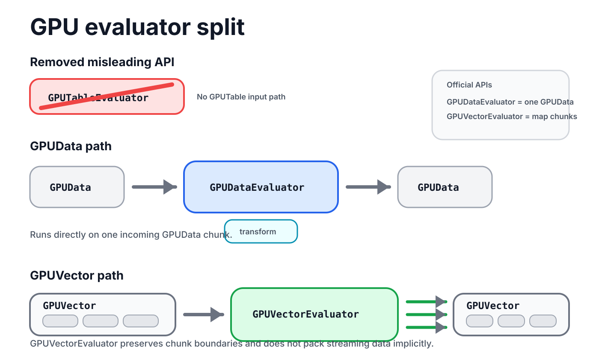

import {GPGPUDocsTabs} from '@site/src/components/docs/gpgpu-docs-tabs';

# GPU Evaluators

<GPGPUDocsTabs active="gpu-data-evaluator" />

`@luma.gl/gpgpu` has two evaluator layers:

- `GPUDataEvaluator` runs one lazy transform over one fixed-width `GPUData` chunk or `GPUDataView`.
- `GPUVectorEvaluator` applies one lazy `GPUDataEvaluator` transform independently to every ordered `GPUData` chunk in a `GPUVector`.

There is no `GPUTable` evaluator input path. Streaming code should pass an incoming
`GPUData` chunk or borrowed `GPUDataView` directly to `GPUDataEvaluator` operations, or wrap a `GPUVector`
with `GPUVectorEvaluator` when the same transform should preserve every existing
chunk boundary.



## Usage

### One incoming `GPUData`

```ts
import {GPUDataEvaluator, add} from '@luma.gl/gpgpu';

const offset = GPUDataEvaluator.fromConstant([1, 2, 3]);
const translatedChunk = add(incomingGPUData, offset);

const translatedVector = await translatedChunk.evaluate(device);
```

### One `GPUVector`

```ts
import {GPUDataEvaluator, GPUVectorEvaluator, add} from '@luma.gl/gpgpu';

const offset = GPUDataEvaluator.fromConstant([1, 2, 3]);
const translatedVector = GPUVectorEvaluator.fromGPUVector(vector).mapGPUData(data =>
  add(data, offset)
);

const outputVector = await translatedVector.evaluate(device);
```

`GPUVectorEvaluator` preserves `vector.data[]` order and chunk boundaries. It does
not combine streaming batches or pack buffers implicitly.

### Interleaved attribute input

```ts
import {add} from '@luma.gl/gpgpu';
import {makeGPUDataViewFromAttribute} from '@luma.gl/gpgpu/gpu-data';

const positions = makeGPUDataViewFromAttribute({
  buffer: interleavedBuffer,
  bufferLayout,
  attributeName: 'positions',
  length: instanceCount
});

const translatedPositions = add(positions, [10, 0, 0]);
const packedOutput = await translatedPositions.evaluate(device);
```

Input views retain their offset and stride, so multiple attributes may borrow
the same interleaved buffer. Operation results use newly materialized packed
outputs by default. Call `setTargetBuffer()` before evaluation to direct an
operation result into an existing buffer range.

### Evaluate into an existing buffer

```ts
import {cleanEvaluate, fround, GPUDataEvaluator} from '@luma.gl/gpgpu';

const source = GPUDataEvaluator.fromArray(new Float64Array(values), {size: 3});
const splitPositions = fround(source);

splitPositions.setTargetBuffer({
  buffer: attributeBuffer,
  byteOffset: destinationByteOffset
});

await cleanEvaluate(device, splitPositions);
```

The target is borrowed. Evaluation writes directly into `attributeBuffer` and
does not allocate or copy through a separate output buffer. `cleanEvaluate()`
recycles unreferenced owned dependency buffers, but preserves the borrowed root
target. Calling `splitPositions.destroy()` is not required to release the target
and never destroys `attributeBuffer`.

## `GPUDataEvaluator`

`GPUDataEvaluator` describes a 2D row layout backed by CPU values, one borrowed
`GPUData` chunk, borrowed `GPUDataView`, another `GPUDataEvaluator`, or a lazy `Operation` output. Each
row contains `size` scalar elements of the same numeric type.

### `GPUDataEvaluatorProps`

| Property | Type | Description |
| --- | --- | --- |
| `id?` | `string` | Optional debug name used by `toString()`. |
| `type` | `SignedDataType` | Scalar element type, such as `'float32'` or `'uint32'`. |
| `size` | `number` | Number of scalar elements in each row. |
| `offset?` | `number` | Byte offset to the first element of the first row. Defaults to `0`. |
| `stride?` | `number` | Byte distance between adjacent rows. Defaults to `ValueType.BYTES_PER_ELEMENT * size`. |
| `normalized?` | `boolean` | Whether integer values are normalized when exposed as vertex formats. |
| `value?` | `TypedArray` | CPU-side data for the evaluator. |
| `buffer?` | `Buffer \| DynamicBuffer` | Borrowed GPU buffer backing this evaluator. |
| `gpuData?` | `GPUData` | Borrowed fixed-width GPUData chunk backing this evaluator. |
| `format?` | `GPUVectorFormat` | Optional memory format preserved for GPUVector interop. |
| `source?` | `Operation \| GPUDataEvaluator \| null` | Lazy source for this evaluator. |
| `isConstant?` | `boolean` | Whether every row shares the same value. Defaults to `false`. |
| `length?` | `number` | Row count. Optional when `isConstant` is `true` or `value` is provided. |

### Static Methods

#### `GPUDataEvaluator.fromArray(value, props?): GPUDataEvaluator`

Creates one evaluator from a typed array or numeric array. Plain JavaScript
arrays use `props.type` or `'float32'` by default. `Float64Array` inputs are
reinterpreted as `uint32` pairs for GPU-oriented operations such as `fround()`.

#### `GPUDataEvaluator.fromConstant(value, type?): GPUDataEvaluator`

Creates one constant evaluator with a shared row value. A scalar becomes a
one-element row, and an array becomes a row with `value.length` elements.

#### `GPUDataEvaluator.fromGPUData(data, options?): GPUDataEvaluator`

Creates one evaluator view over a fixed-width `GPUData` chunk. The input
must have a fixed-width `GPUData.format` and matching `rowByteLength`. Strided
rows are preserved. The evaluator borrows `data.buffer` and does not destroy it.

#### `GPUDataEvaluator.fromGPUDataView(view, options?): GPUDataEvaluator`

Creates an evaluator over a borrowed fixed-width `GPUDataView`, preserving its
format, length, byte offset, and byte stride. Existing operations accept views
directly through `GPUDataEvaluatorInput`.

CPU, WebGL, and WebGPU support strided 32-bit component formats. Other formats
remain subject to backend capabilities; unsupported WebGPU storage types fail
explicitly rather than being repacked. Offsets and strides must be aligned to
the stored scalar component width.

### Methods

#### `setTargetBuffer(target: GPUDataEvaluatorTargetBuffer): void`

Assigns borrowed storage for the next evaluation of a deferred operation
output. This method is only valid before evaluation and on an evaluator whose
source is an `Operation`.

| Property | Type | Description |
| --- | --- | --- |
| `buffer` | `Buffer` | Borrowed buffer that receives the operation output. |
| `byteOffset?` | `number` | Byte offset of the first output row. Defaults to `0`. |
| `byteStride?` | `number` | Byte distance between adjacent output rows. Defaults to the operation output's current packed stride. Backend layout restrictions still apply. |

`setTargetBuffer()` records the target without changing the evaluator's logical
layout. When evaluation begins, the target replaces the normal pooled output
allocation and `offset`, `stride`, and `byteLength` are updated to describe the
physical target layout. The target buffer must belong to the evaluation device
and be large enough for the resulting range.

The evaluator borrows the assigned buffer. Evaluating or destroying the
evaluator never transfers ownership of or destroys that buffer.

#### `evaluate(device: Device, options?): Promise<GPUVector>`

Materializes one single-chunk `GPUVector` on the provided device. Lazy
dependencies are evaluated before the operation handler writes the output.

#### `evaluateSync(device: Device, options?): GPUVector`

Materializes one single-chunk `GPUVector` synchronously. This is useful for
call sites that must stay synchronous, but it is stricter than `evaluate()`:

- backend lookup must already be resolved
- dependencies are evaluated recursively without awaiting
- any required CPU value must already be available

If those conditions are not met, `evaluateSync()` throws.

#### `readValue(startRow?: number, endRow?: number): Promise<TypedArray>`

Reads evaluator contents back to the CPU. This is intended for debugging or
inspection and may be slower than staying on the GPU.

#### `destroy(): void`

Releases cached GPU storage owned by this evaluator and prevents future
evaluation. Borrowed buffers supplied through the constructor,
`fromGPUData()`, `fromGPUDataView()`, or `setTargetBuffer()` are not destroyed.

## `GPUVectorEvaluator`

`GPUVectorEvaluator` is the official `GPUVector` path. It wraps ordered
`GPUDataEvaluator` chunks and materializes one output `GPUVector` with the same
chunk boundaries.

### Static Methods

#### `GPUVectorEvaluator.fromGPUVector(vector): GPUVectorEvaluator`

Creates one chunk-preserving evaluator over a fixed-width `GPUVector`. The
vector must have at least one `GPUData` chunk and must not be interleaved.

#### `GPUVectorEvaluator.fromGPUDataEvaluators(evaluators, options?): GPUVectorEvaluator`

Creates one vector evaluator from already-built ordered chunk evaluators.

### Methods

#### `mapGPUData(transform): GPUVectorEvaluator`

Applies one lazy `GPUDataEvaluator` transform independently to each preserved
chunk. Use this for row-local streaming transforms that should not repack source
batches.

#### `evaluate(device: Device, options?): Promise<GPUVector>`

Materializes every chunk evaluator and returns one `GPUVector` with preserved
chunk order and boundaries.

#### `evaluateSync(device: Device, options?): GPUVector`

Synchronously materializes every chunk evaluator and returns one `GPUVector`
with preserved chunk order and boundaries. This has the same synchronous
requirements as `GPUDataEvaluator.evaluateSync()`.

#### `destroy(): void`

Releases cached GPU resources owned through child `GPUDataEvaluator` instances.

## Remarks

- Leaf operations accept `GPUDataEvaluator`, `GPUData`, or `GPUDataView`, not `GPUVector`.
- Use `GPUVectorEvaluator.fromGPUVector(vector).mapGPUData(...)` for vector-wide
  transforms that should preserve streaming chunks.
- `GPUDataEvaluator` operation outputs own their automatically allocated
  backing resource. Outputs configured with `setTargetBuffer()` borrow their
  backing resource instead.
- Borrowed `GPUData` chunks are not destroyed by `GPUDataEvaluator.destroy()`.
- Borrowed `GPUDataView` buffers are not destroyed by `GPUDataEvaluator.destroy()`.
- Target buffers assigned with `GPUDataEvaluator.setTargetBuffer()` are not
  destroyed or recycled by the evaluator.
- Synchronous evaluation is intended for already-prepared graphs where backend
  registration and any required CPU values are available up front.

## Experimental explicit-submission POC

### Why this is needed

The portable evaluator is a suitable replacement for backend-specific attribute transforms,
but its WebGPU handlers currently own submission. Separate attribute outputs and chains of
different operation types can therefore call `device.submit()` repeatedly during one deck.gl
update. A host renderer cannot record those operations and its consumers together on an
explicit command encoder or choose a single submission point.

This is a scheduling and integration gap, not an existing GPU ordering bug: sequential queue
submissions already preserve producer/consumer order. Nor does every nested arithmetic call
cause a submission: the evaluator already fuses arithmetic expressions. The useful cases are
multiple outputs and chains crossing operation boundaries, such as arithmetic followed by a
non-contiguous swizzle and another arithmetic expression. GPU aggregation is another prospective
consumer, but reduction support is outside this initial POC.

`GPUEvaluationScope` demonstrates recording those existing row operations without submitting,
then letting the caller submit once. Tests verify submission count and results; a frame-time
improvement has not been measured. This draft API is intended to establish the execution and
resource-lifetime contract before extending every backend handler or integrating deck.gl.

### Example

```ts
import {GPUDataEvaluator, GPUEvaluationScope, add, multiply, swizzle} from '@luma.gl/gpgpu';

const source = GPUDataEvaluator.fromArray(new Float32Array([1, 2, 3, 4]), {size: 2});
const scaled = multiply(source, 2);
const reordered = swizzle(scaled, [1, 0]);
const positions = add(reordered, 1);
const colors = add(source, 10);

const scope = new GPUEvaluationScope(device);
try {
  const positionVector = await scope.evaluate(positions);
  const colorVector = await scope.evaluate(colors);
  // No evaluator submission has occurred. Additional commands consuming these
  // buffers may be appended to scope.commandEncoder before submission.
  scope.submit();
} catch (error) {
  // Evaluation errors already cancel the scope; cancel() also handles errors
  // in caller-appended commands and is harmless after an earlier cancellation.
  scope.cancel();
  throw error;
}
```

The existing `evaluator.evaluate(device)` API retains its current behavior. This POC does not
change its submission policy, fuse additional shaders, or replace the command-graph API.

### Submission and lifetime contract

- A scope is WebGPU-only and owns its encoder. Append commands through `commandEncoder`, but
  call `scope.submit()` to finish and submit it. Do not finish or submit the encoder separately.
- Await each `scope.evaluate()` before starting another evaluation, submitting, or cancelling.
  Evaluation finishes CPU encoding; it does not wait for GPU completion.
- The scope retains participating evaluators and computation resources. Evaluator destruction,
  readback, and evaluation outside the scope are rejected while the scope is pending. Existing
  output buffers remain available for binding to later commands on the same encoder.
- Successful submission releases these evaluator leases. Queue ordering allows subsequent GPU
  consumers without a CPU wait. Explicit readback still waits for the GPU in the usual way.
- `cancel()` is harmless after submission or an earlier cancellation. Otherwise it discards
  commands and invalidates newly materialized evaluator views, allowing a
  fresh evaluation. Existing materializations are preserved. Assigned output targets and layouts
  are restored so a cancelled operation can be retried.
- Evaluation failure cancels the entire scope, including earlier successful evaluations.
  Submitted and cancelled scopes cannot be reused. Batch submission must not race evaluation.
- The scope borrows external buffers. The application must keep raw buffers alive and unchanged
  until submission and must not read pending returned vectors directly. These raw resource
  operations cannot be intercepted by evaluator leases. CPU input uploads may occur immediately;
  cancellation discards encoded computation, not queue writes or external application changes.

### Deliberate POC limits

Only single-chunk `GPUDataEvaluator` evaluation and opt-in WebGPU row handlers are supported:
arithmetic, dot, equalAll, fround, interleave, length, select, and swizzle. CPU fallback,
`GPUVectorEvaluator`, multi-pass extent, gather, segmentedMap, sequence, color conversion,
and raw-byte casts are not included. Unsupported handlers fail explicitly rather than internally
submitting. The existing immediate-submission API remains available for those operations.

Before promoting this API, extend supported handlers and chunk-preserving vector evaluation,
measure representative deck.gl frame workloads, and decide whether this execution scope should
instead lower into the existing GPU command graph. Caller-owned encoders and a coordinated
submission receipt would also need an explicit lifetime design; a bare `submit: false` flag is
insufficient.
