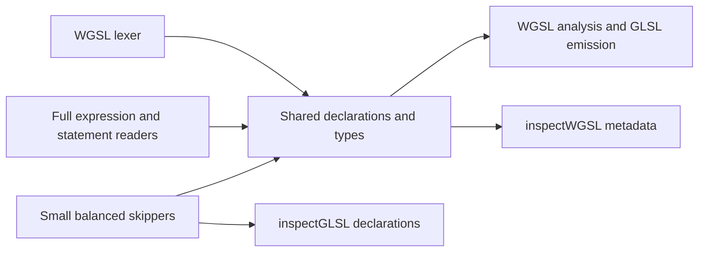

# Shader inspection

**Experimental · Available from luma.gl v10.**

`@luma.gl/slang/inspect` exposes `inspectWGSL()` and `inspectGLSL()`. Both return declaration
metadata in the same intermediate representation without generating target code or creating a GPU
shader. Import either function independently: the other parser and the compiler backend are
removed by tree shaking. These functions do not add dependencies to core's runtime scanner.

```typescript
import {inspectWGSL, inspectGLSL} from '@luma.gl/slang/inspect';

const wgsl = inspectWGSL(`
  @vertex fn vertexMain(@location(0) position: vec3f)
    -> @builtin(position) vec4f { return vec4f(position, 1.0); }
`, {sourceName: 'triangle.wgsl'});

const glsl = inspectGLSL(`#version 300 es
  layout(location = 0) in vec3 position;
  void main() { gl_Position = vec4(position, 1.0); }
`, {sourceName: 'triangle.vert', stage: 'vertex'});

console.log(wgsl.entryPoints, glsl.globals);
```

## Result and limits

Both functions return `ShaderInspection`: `language`, `sourceName`, `structures`, `globals`,
`functions` and `entryPoints`; GLSL also reports its `version` directive when present.

Declarations include original names and source locations (`offset`, `line`, `column`,
`sourceName`). Scalar/vector/matrix/array/struct types use language-neutral discriminated objects.
Matrices report columns and rows explicitly. Arrays retain literal lengths or an unresolved WGSL
`lengthExpression`; inferred WGSL globals report `{kind: 'inferred'}`. Texture/sampler handles
report `{kind: 'opaque', name: ...}`. No expression type is guessed or inferred by inspection.

Variables retain qualifiers, interface attributes and explicit resource bindings. GLSL blocks
also include their block name, optional instance name and members. GLSL layout qualifiers are
returned as normalized decimal strings/flags (unsigned suffixes are removed), not calculated byte offsets. WGSL resource groups are explicit;
a GLSL binding has no group unless a `set` qualifier is present. Functions retain parameters,
return types and whether a body exists. WGSL entry points retain stage attributes; GLSL `main`
definitions are entry points, with a stage only when the caller supplies `stage`.

`inspectWGSL()` shares the lexer, module declarations, types and attributes with the
[full WGSL frontend](./wgsl.md), and balances/skips function bodies and initializers. It does not
include the full expression/statement grammar. It does not run semantic analysis, materialize constants, reject layouts
that differ from GLSL std140, or require an entry point. Aliases are expanded into their declared
types. Compute/storage/pointers in declarations and other unsupported declarations still raise a
diagnostic. Balanced bodies may contain constructs the full compiler does not yet support.

`inspectGLSL()` implements a basic GLSL declaration parser that produces this intermediate
representation directly. It supports 32-bit scalars/vectors, float matrices, structs, explicit
literal-sized or unsized arrays, uniforms, interface/storage blocks, sampler/image handle types,
precision/interpolation/storage qualifiers, layout qualifiers, prototypes and function definitions.
Integer layout values and dimensions share one literal reader for decimal, hexadecimal and octal
forms, with optional unsigned suffixes.
Type-level and declarator-level array dimensions are supported, including parameters and return
types. Function bodies and initializers are balanced and skipped, rather than parsed into expression or
statement IR. Initializer values and implicit builtins are not reflected. Function overloads and
prototypes are returned separately in source order. This is not yet a GLSL transpiler frontend.

GLSL source must be preprocessed: `#version` and `#extension` are accepted; macros, conditionals,
includes and `#line` are rejected instead of returning misleading metadata. Symbolic GLSL array
lengths, 64-bit types, general semantic validation and linking are outside this first subset.

Unsupported/incomplete syntax raises `ShaderInspectionError` (the shared diagnostic class), with
the source location. Results contain plain serializable data, without internal syntax/call graphs.
Neither function replaces the destination driver's shader validator.

## Comparison with core's WGSL scanner

Core's `scanWGSLInterface()` is now a re-export of the implementation owned by
`@luma.gl/shaders/wgsl`. `getShaderLayoutFromWGSL()` delegates to that scanner. It remains the
appropriate runtime path for deriving a pipeline layout; this API does not replace it.

| Capability | Existing core scanner | `inspectWGSL()` | `inspectGLSL()` |
| --- | --- | --- | --- |
| Result | Pipeline `ShaderLayout` | Module declaration IR | Same declaration IR |
| Entry points | Selected vertex attributes | All vertex/fragment entries | All `main` definitions; caller supplies stage |
| Functions/struct members | Scanned as needed for pipeline layout | Exposed with locations/types | Exposed with locations/types |
| Bodies | Skipped | Balanced and skipped | Balanced and skipped |
| Resources | Broader WebGPU bindings, including storage/compute use | Current rendering subset | GLSL uniforms/interface/storage blocks and handles |
| Ambiguity/unsupported input | Returns `null` for an explicit-layout fallback | Source diagnostic | Source diagnostic |
| Semantic/type validation | No full validation | No semantic analysis | No semantic analysis |

Tests compare the scanner and inspector on a shared vertex/resource fixture. A scanner replacement
would require broader WGSL declaration support and a deliberate adapter to `ShaderLayout`; keeping
the two contracts separate avoids narrowing core's existing runtime support.

## Bundle comparison

Standalone browser ESM bundles, esbuild minification and gzip level 9, retaining only the named
API through the public inspection barrel:

| Retained API | Minified bytes | Gzip bytes |
| --- | ---: | ---: |
| `inspectWGSL()` | 9816 | 4038 |
| `inspectGLSL()` | 6800 | 3186 |
| Core `scanWGSLInterface()` | 8312 | 3003 |
| Both inspectors | 15950 | 6174 |

The WGSL inspector costs about 1.0 KB gzip more than the runtime scanner. Compared with using
its full syntax parser, the declaration reader reduces WGSL inspection from 4,711 to 4,038 gzip
bytes (14.3%). Both inspectors together fall from 6,898 to 6,174 bytes (10.5%). GLSL was already a
declaration-only parser; its small size increase includes type-level arrays and unsigned literal
support added during review. Neither inspector imports semantic analysis, layout lowering, the
Slang parser/registry or code generation.

## Comparison with standalone syntax parsers

The syntax-only bundles retain the named internal parser entry rather than an inspector or
transpiler. They exclude metadata projection, semantic analysis and code generation:

| Syntax/scanner entry | Minified bytes | Gzip bytes |
| --- | ---: | ---: |
| Existing core WGSL scanner | 8312 | 3003 |
| Existing Slang syntax parser | 10506 | 3509 |
| Original full WGSL syntax parser (before this PR) | 10320 | 4047 |
| New small WGSL declaration parser | 7918 | 3398 |
| New full WGSL syntax parser | 10808 | 4329 |

The small WGSL parser is 16.0% smaller gzip than the original full parser, and 21.5% smaller than
the new full reader. Sharing adds 282 bytes to the standalone full syntax entry (about 0.3 KB to
the entire WGSL compiler). Core's scanner remains smaller and returns a different pipeline-layout
contract. GLSL's declaration parser already produces inspection IR directly, so its syntax and
inspection measurements are the same. Current syntax entries are included in the reproducible
bundle report; the original WGSL row is the pre-refactor baseline.

## Shared small and full readers

The WGSL lexer and declaration/type grammar are implemented once. The declaration parser receives
a reader factory: the compiler supplies the full expression/statement parser; inspection supplies
small balanced syntax skippers. The full frontend never imports the skippers, and inspection never
imports the full body parser. Both small WGSL and GLSL readers reuse the same delimiter skipper;
GLSL also reuses the tokenizer used by the full Slang frontend. A full GLSL expression/statement
frontend is not implemented yet.



Tests compare full and small WGSL declaration metadata for every runnable sample, and dependency
graph tests ensure body readers/skippers stay in their respective bundles. After the split the
full WGSL compiler remains about 37.4 KB gzip; the Slang-only compiler stays unchanged at 32.1 KB.

The scanner fixture measures its source implementation directly (the core re-export adds no
retained code), avoiding dependence on built workspace packages. Reproduce all measurements with
`node scripts/bundle-size.mjs`. Tight budgets and emitted-module graph checks guard each inspector
and their combined bundle.
