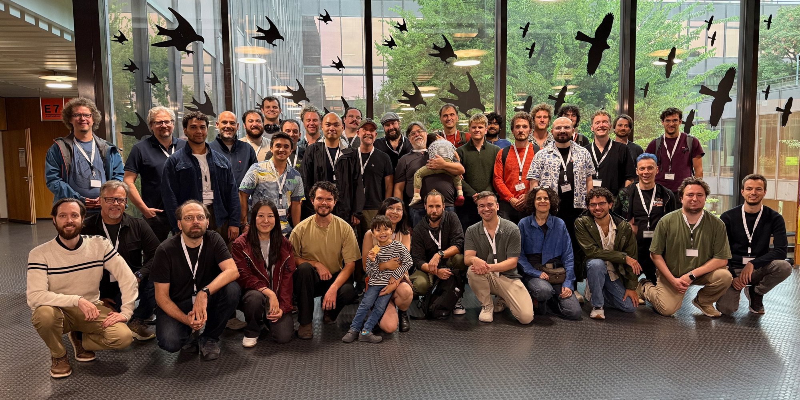

# Community

## Open governance and community[​](#open-governance-and-community "Direct link to Open governance and community")

luma.gl is part of the [Open Visualization community](https://www.openvisualization.org/), an OpenJS Foundation collaboration space that supports open governance and shared stewardship of visualization projects. Community participation and technical contributions are welcome.

There are many ways to help: report a problem, improve an explanation or example, review a change, or contribute code and tests. Whether your change is small or large, we welcome your perspective.

Participants at the 2026 Open Visualization Collaborator Summit in Zürich.

## Meet the community[​](#meet-the-community "Direct link to Meet the community")

Open Visualization contributors and community members meet at an annual [collaborator summit](https://www.openvisualization.org/summits) to share work, exchange ideas, and discuss the future of the projects.

We would love to meet you! The summit page has the latest information about the next event’s schedule, location, and speaker submissions.

Between summits, join the [OpenJS Slack workspace](https://slack-invite.openjsf.org/) to connect with the community, and attend the biweekly Open Visualization meetings to share ideas and discuss ongoing work. The [community page](https://www.openvisualization.org/#get-involved) has the meeting calendar and ways to get involved.

Ready to help? Read the [Contributing guide](https://luma.gl/docs/developer-guide/contributing.md) for repository setup, pull requests, and documentation guidance.
