# Packages

luma.gl is a collection of composable GPU packages. Start with the primary packages, then add the focused tools and integrations your application needs. Each card links to the relevant package or subpath overview and API reference.

## Primary Packages[​](#primary-packages "Direct link to Primary Packages")

The building blocks for GPU resources, execution graphs, rendering, and shader composition. WebGPU and WebGL2 backends are included in core through their own entry points.

* [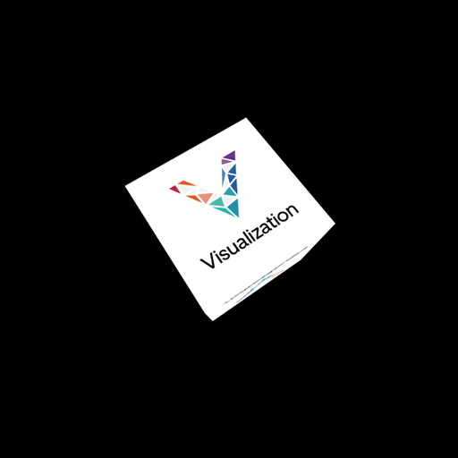](https://luma.gl/docs/api-reference/core.md)
  ### [@luma.gl/<!-- -->core](https://luma.gl/docs/api-reference/core.md)
  [Portable GPU resources, shader types, and WebGPU and WebGL2 backends.](https://luma.gl/docs/api-reference/core.md)

  [API reference →](https://luma.gl/docs/api-reference/core.md)
* [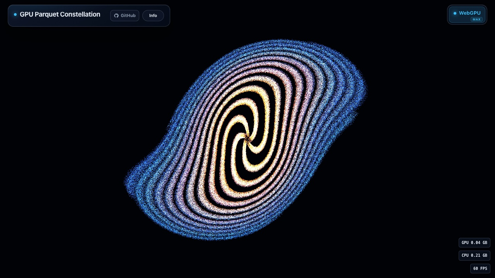](https://luma.gl/docs/api-reference/graph.md)
  ### [@luma.gl/<!-- -->graph](https://luma.gl/docs/api-reference/graph.md)
  [Schedule GPU work and compose graph-based processing pipelines.](https://luma.gl/docs/api-reference/graph.md)

  [API reference →](https://luma.gl/docs/api-reference/graph.md)
* [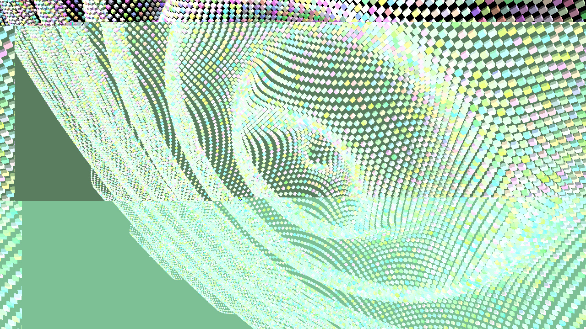](https://luma.gl/docs/api-reference/engine.md)
  ### [@luma.gl/<!-- -->engine](https://luma.gl/docs/api-reference/engine.md)
  [Models, geometry, animation, picking, and rendering helpers.](https://luma.gl/docs/api-reference/engine.md)

  [API reference →](https://luma.gl/docs/api-reference/engine.md)
* [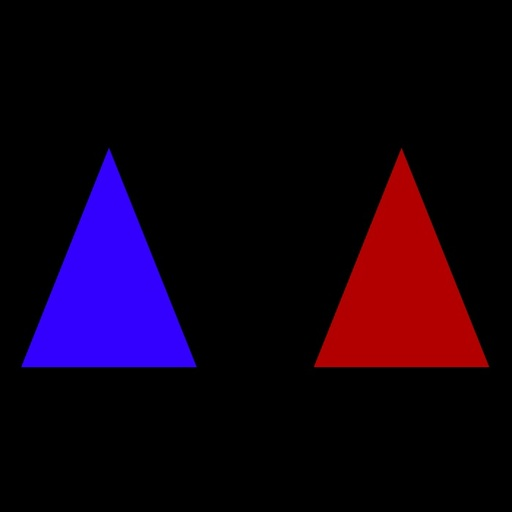](https://luma.gl/docs/api-reference/shaders.md)
  ### [@luma.gl/<!-- -->shaders](https://luma.gl/docs/api-reference/shaders.md)
  [Compose WGSL and GLSL with reusable shader modules and hooks.](https://luma.gl/docs/api-reference/shaders.md)

  [API reference →](https://luma.gl/docs/api-reference/shaders.md)

## Smaller Packages[​](#smaller-packages "Direct link to Smaller Packages")

Focused packages and optional engine subpaths for text, computation, effects, assets, and data integration. Availability and API maturity vary by entry point; check its overview before adopting it.

* [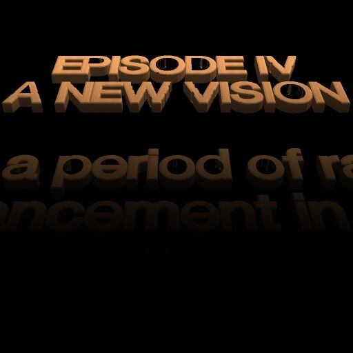](https://luma.gl/docs/api-reference/engine/text.md)
  ### [@luma.gl/<!-- -->engine/text](https://luma.gl/docs/api-reference/engine/text.md)
  [Experimental](https://luma.gl/docs/api-reference/engine/text.md)

  [Render GPU text with font atlases and reusable layout helpers.](https://luma.gl/docs/api-reference/engine/text.md)

  [API reference →](https://luma.gl/docs/api-reference/engine/text.md)
* [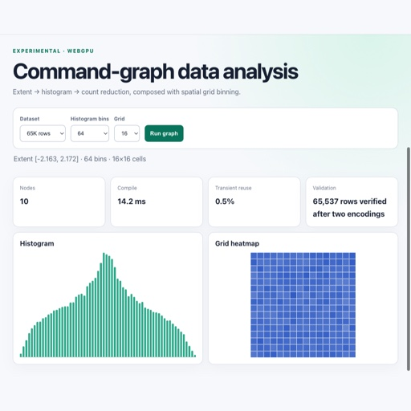](https://luma.gl/docs/api-reference/graph/gpu-evaluation.md)
  ### [@luma.gl/<!-- -->graph/gpu-simple-graph](https://luma.gl/docs/api-reference/graph/gpu-evaluation.md)
  [GPU data primitives and immediate compute operations without CPU readback.](https://luma.gl/docs/api-reference/graph/gpu-evaluation.md)

  [API reference →](https://luma.gl/docs/api-reference/graph/gpu-evaluation.md)
* [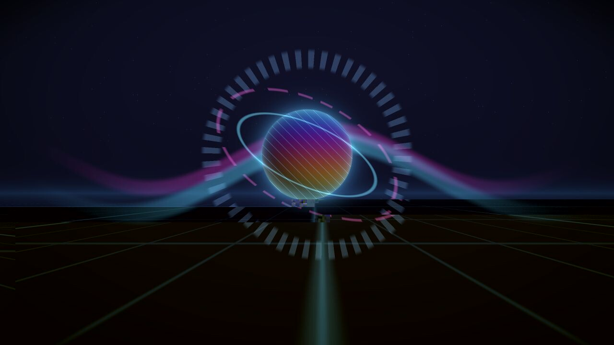](https://luma.gl/docs/api-reference/effects.md)
  ### [@luma.gl/<!-- -->engine/effects](https://luma.gl/docs/api-reference/effects.md)
  [Build post-processing pipelines with composable image and lighting effects.](https://luma.gl/docs/api-reference/effects.md)

  [API reference →](https://luma.gl/docs/api-reference/effects.md)
* [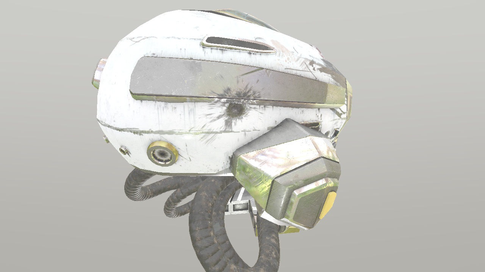](https://luma.gl/docs/api-reference/gltf.md)
  ### [@luma.gl/<!-- -->gltf](https://luma.gl/docs/api-reference/gltf.md)
  [Load glTF assets, materials, lights, skins, and animations.](https://luma.gl/docs/api-reference/gltf.md)

  [API reference →](https://luma.gl/docs/api-reference/gltf.md)
* [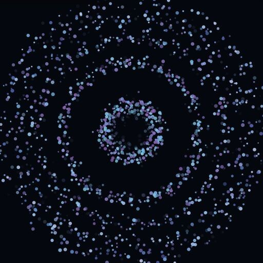](https://luma.gl/docs/api-reference/arrow.md)
  ### [@luma.gl/<!-- -->graph/arrow](https://luma.gl/docs/api-reference/arrow.md)
  [Experimental](https://luma.gl/docs/api-reference/arrow.md)

  [Convert Arrow vectors, tables and rendering data through optional /arrow subpaths.](https://luma.gl/docs/api-reference/arrow.md)

  [API reference →](https://luma.gl/docs/api-reference/arrow.md)
* [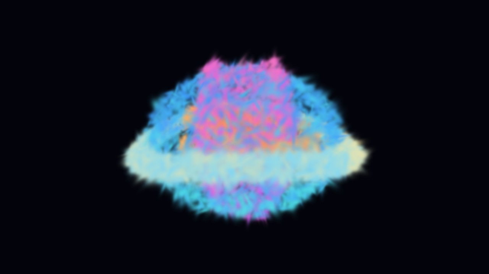](https://luma.gl/docs/api-reference/splats.md)
  ### [@luma.gl/<!-- -->engine/splats](https://luma.gl/docs/api-reference/splats.md)
  [Experimental](https://luma.gl/docs/api-reference/splats.md)

  [Stream, sort, and render Gaussian splat scenes.](https://luma.gl/docs/api-reference/splats.md)

  [API reference →](https://luma.gl/docs/api-reference/splats.md)
* [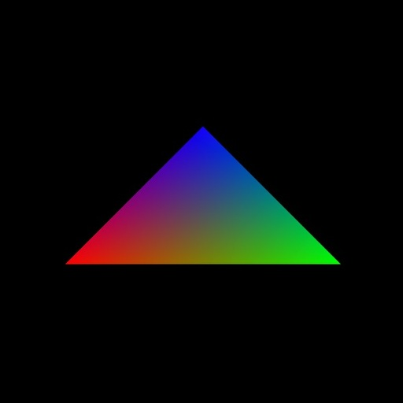](https://luma.gl/docs/api-reference/test-utils.md)
  ### [@luma.gl/<!-- -->core/test-utils](https://luma.gl/docs/api-reference/test-utils.md)
  [Create test devices and inspect resource ownership with the null backend.](https://luma.gl/docs/api-reference/test-utils.md)

  [API reference →](https://luma.gl/docs/api-reference/test-utils.md)

## Exploratory modules[​](#exploratory-modules "Direct link to Exploratory modules")

Explore scene APIs, shader languages, and rendering integrations under active development. These APIs and supported workflows may change.

* [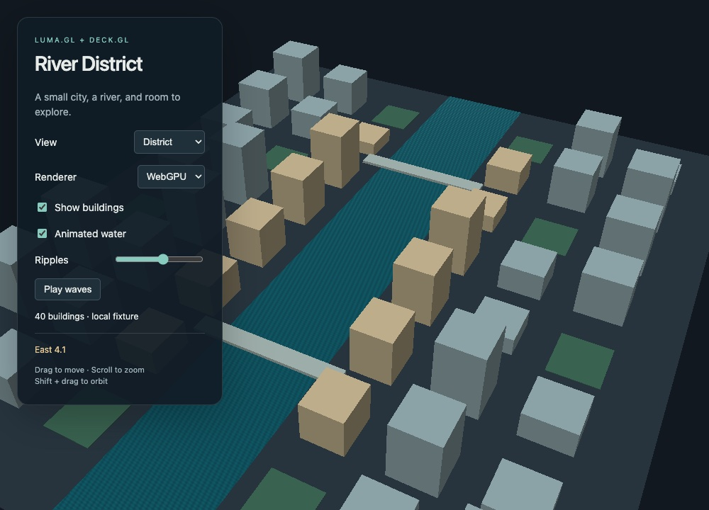](https://luma.gl/docs/api-reference/scene)
  ### [@luma.gl/<!-- -->anari](https://luma.gl/docs/api-reference/scene)
  [Exploratory](https://luma.gl/docs/api-reference/scene)

  [Describe 3D scenes and switch renderers through an ANARI-inspired scene API.](https://luma.gl/docs/api-reference/scene)

  [API reference →](https://luma.gl/docs/api-reference/scene)
* [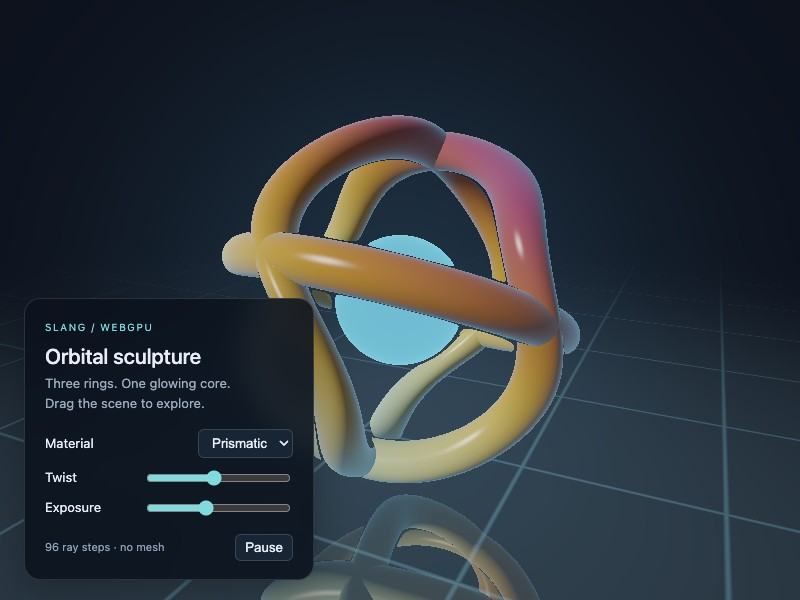](https://luma.gl/docs/api-reference/slang.md)
  ### [@luma.gl/<!-- -->slang](https://luma.gl/docs/api-reference/slang.md)
  [Exploratory](https://luma.gl/docs/api-reference/slang.md)

  [Compile Slang shaders with reflection and typed shader contracts.](https://luma.gl/docs/api-reference/slang.md)

  [API reference →](https://luma.gl/docs/api-reference/slang.md)
* [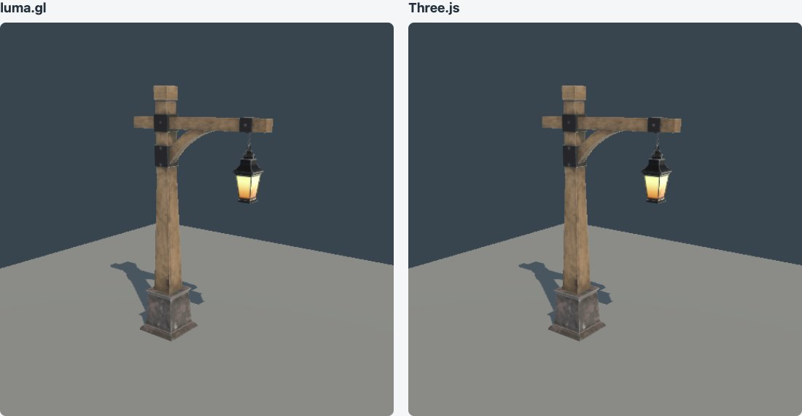](https://luma.gl/docs/api-reference/three.md)
  ### [@luma.gl/<!-- -->three](https://luma.gl/docs/api-reference/three.md)
  [Exploratory](https://luma.gl/docs/api-reference/three.md)

  [Combine luma.gl GPU workflows with Three.js scenes and renderers.](https://luma.gl/docs/api-reference/three.md)

  [API reference →](https://luma.gl/docs/api-reference/three.md)

For a first application, follow [Getting Started](https://luma.gl/docs/getting-started.md). For conceptual walkthroughs, browse the [API Guide](https://luma.gl/docs/api-guide.md).
